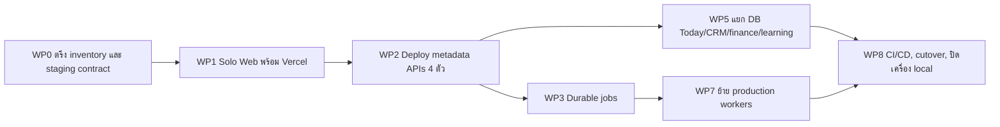

# 01 — Product Requirements (PRD)

## 1. ปัญหาและเป้าหมาย

### 1.1 ปัญหา

| # | ปัญหา | ผลกระทบ | หลักฐาน |
|---|---|---|---|
| PB-1 | เครื่องมือของเจ้าของกระจายอยู่หลาย webapp (`apps/*-web`) ต้องเปิดหลายแอป/หลายพอร์ต | สลับงานยาก ดูแลหลาย frontend | spec unified web shell §0 |
| PB-2 | แอปเดิมผูกกับ backend บนเครื่อง local (loopback) | ปิด laptop แล้วใช้งานไม่ได้ | แผน migration "Goal" |
| PB-3 | BFF เดิมอาจแนบ credential ฝั่ง server ให้ request ที่ไม่ได้ยืนยันตัวตน | ข้อมูลส่วนตัวรั่วถ้าเปิดบนอินเทอร์เน็ต | แผน migration "Review Focus" ข้อ 1–2 |

### 1.2 เป้าหมาย

| ID | เป้าหมาย | ตัวชี้วัด | เป้าหมายเสนอ |
|---|---|---|---|
| G-1 | webapp เดียว เมนูเดียว เปลี่ยน module โดยไม่เปิดหลายแอป | จำนวน module ที่ย้ายเข้ามา (`migrated: true`) | 8/10 ปัจจุบัน; CRM/วิดีโอรอบถัดไป |
| G-2 | ใช้งานผ่านเว็บบน Vercel ได้แม้ปิดเครื่อง local (phase แรก: metadata 4 module) | smoke 13 checks ผ่าน + owner login/read/logout ผ่าน | ผ่านครบก่อน hosted acceptance **[ต้องยืนยัน วันที่]** |
| G-3 | ข้อมูลส่วนตัวเข้าถึงได้เฉพาะเจ้าของ | anonymous read ผ่าน BFF/API ต้องได้ 401/403 | 100% ของ 8 anonymous checks |
| G-4 | backend scale/ย้ายได้แยกกัน | ทุก module มี origin env ของตนเอง | ครบทุก backend (test `gives every module its own origin variable`) |
| G-5 | คุมต้นทุน | ค่าโฮสติ้ง metadata phase แรกต่อเดือน | กรอบวางแผน US$30–50 (ไม่ใช่ hard cap) |

## 2. ผู้ใช้ / Persona

| ID | Persona | เป้าหมาย | ช่องทาง |
|---|---|---|---|
| P-OWN | เจ้าของ Solo Empire (ผู้ใช้เดียว, `tenant_id=owner`) | ดูงานวันนี้, จัดการงานผลิต, ค้นเอกสาร, ดูบัญชี/แอป/SaaS/คลาวด์/โควตา AI | เบราว์เซอร์ → Solo Web |
| P-OPS | ผู้ดูแล/release runner (บทบาทของเจ้าของเอง **[สมมติฐาน]**) | ตั้ง config, ตรวจ preflight/smoke, deploy, rollback | CLI + provider console |

ไม่มี persona ผู้ใช้สาธารณะใน source ปัจจุบัน **[ต้องยืนยัน]** (ดู `00-overview.md`)

## 3. ขอบเขต

### 3.1 In scope (phase แรก — metadata staging)

- Shell + เมนูภาษาไทย, หน้า `/login`, owner OIDC login/logout, session เข้ารหัส
- BFF proxy พร้อม Host/Origin guard และ service JWT รายบริการ
- module ที่เปิดใน hosted: บัญชี (`/accounts`), แอปและ API (`/integrations`), SaaS ฟรี (`/saas`), คลังความรู้ (`/knowledge`)
- `GET /api/health` สำหรับ configuration readiness
- Vercel (Solo Web) + Railway (4 APIs, replica เดียว ไม่มี DB/disk/worker)

### 3.2 อยู่ใน source แต่ไม่อยู่ในเกณฑ์รับ phase แรก

- วันนี้ (`/today`), คลาวด์ (`/cloud`), งานผลิต (`/production`): hosted ตอบ `service_auth_unavailable` จน backend รองรับ scoped owner auth
- AI Usage (`/ai-usage`): มี service JWT scope `ai-usage:read` แล้ว แต่ไม่อยู่ใน `active_modules` ของ staging **[ต้องยืนยัน]** ว่าจะเปิดใน phase ใด

### 3.3 Out of scope

- CRM, Video Studio (ยังลิงก์ไปแอปเดิม `http://127.0.0.1:3200`, `:3400`)
- `/finance`, `/learning` (proposed ในแผน migration)
- การย้าย DB/jobs, R2, cron, worker ของ Today/CRM/Production (WP3–WP8)
- multi-tenant, ผู้ใช้หลายคน, distributed session revocation, IdP backchannel logout

## 4. ฟีเจอร์หลักพร้อมลำดับความสำคัญ

| ID | ฟีเจอร์ | Priority | Phase | สถานะ source |
|---|---|---|---|---|
| F-01 | Owner login ด้วย OIDC (PKCE S256, state, nonce) + owner allowlist | Must | 1 | สร้างแล้ว, unit test ผ่าน |
| F-02 | Encrypted session + logout แบบ same-Origin POST | Must | 1 | สร้างแล้ว |
| F-03 | Shell + เมนู + หน้าแรกรวม module | Must | 1 | สร้างแล้ว |
| F-04 | BFF proxy ที่มี allowlist method/path และ guard | Must | 1 | สร้างแล้ว |
| F-05 | Service JWT RS256 รายบริการ อายุ ≤120 วินาที | Must | 1 | สร้างแล้ว |
| F-06 | Configuration health endpoint | Must | 1 | สร้างแล้ว |
| F-07 | Module บัญชี / แอปและ API / SaaS / คลังความรู้ (read-only) | Must | 1 | สร้างแล้ว |
| F-08 | Module AI Usage + แจ้งเตือนเบราว์เซอร์แบบ opt-in | Should | 1–2 **[ต้องยืนยัน]** | สร้างแล้ว |
| F-09 | Module วันนี้ (อ่าน + แก้สถานะงาน) | Should | 2 (domain data) | local เท่านั้น |
| F-10 | Module คลาวด์ (read-only) | Should | 2 | local เท่านั้น |
| F-11 | Production Console (คลังไฟล์, โปรเจกต์, flow, เส้นทางแปลงไฟล์) | Should | 3 (durable production) | local เท่านั้น |
| F-12 | ย้าย CRM / วิดีโอเข้า shell | Could | ภายหลัง | ยังเป็นลิงก์ภายนอก |

## 5. ตัวชี้วัดความสำเร็จ

| ตัวชี้วัด | วิธีวัด | เป้าหมาย |
|---|---|---|
| Hosted smoke | `node apps/solo-web/scripts/staging-smoke.mjs --json` | 13/13 ผ่าน |
| Config preflight | `staging-preflight.mjs --all --json` | `ready: true` |
| Owner journey | browser acceptance: login → อ่าน 4 module → logout | ผ่านครบ **[ต้องยืนยัน: ยังไม่มีชุดทดสอบ browser]** |
| ความปลอดภัย | anonymous read ผ่าน BFF/API | 401/403 ทุกครั้ง |
| ต้นทุน | บิล Vercel + Railway ส่วนเพิ่ม | อยู่ในกรอบ US$30–50/เดือน **[ต้องยืนยันหลังวัดจริง]** |
| Uptime | — | **[ต้องยืนยัน]** ยังไม่มีเป้าหมาย SLA |

## 6. Roadmap / Phase

อ้างอิง work package ใน `docs/superpowers/plans/2026-10-04-vercel-distributed-paas-migration.md`

| Phase | เนื้อหา | สถานะ |
|---|---|---|
| 1 metadata | Solo Web + accounts/integrations/saas-catalog/knowledge | source พร้อม, resource scaffold แล้ว, ยังไม่ deploy |
| 2 domain data | Today, CRM, Cloud (ต้องมี scoped auth + Postgres) | ยังไม่เริ่มบน hosted |
| 3 durable production | Production Hub (jobs, object storage) | ยังไม่เริ่มบน hosted |

## 7. ข้อสมมติฐานและความเสี่ยง

| ID | ประเภท | รายละเอียด | การจัดการ |
|---|---|---|---|
| A-1 | สมมติฐาน | มีผู้ใช้เดียว (owner tenant) | หากเพิ่มผู้ใช้ต้องออกแบบ multi-tenant/object policy ก่อน |
| A-2 | สมมติฐาน | Google OIDC เป็น IdP ของ staging | ยืนยัน client reference ใน secret store |
| R-1 | ความเสี่ยง | Vercel Hobby จำกัด personal/noncommercial | ใช้ Pro ก่อนใช้งานเชิงพาณิชย์จริง |
| R-2 | ความเสี่ยง | cookie session ที่ถูกขโมยใช้ได้จนหมดอายุ (≤1 ชม.) เพราะไม่มี revocation store | หมุน `SOLO_WEB_SESSION_KEY` หรือถอด subject |
| R-3 | ความเสี่ยง | metadata (เช่นชื่อ/เส้นทางเอกสารใน knowledge) ยังไม่ผ่าน publication review | ห้ามอัปโหลดจน owner review อนุมัติ |
| R-4 | ความเสี่ยง | Railway region ที่ staged คือ `us-west2` ไม่ใช่ Singapore ตามที่ต้องการ | ทดสอบ latency/เลือก region ก่อน acceptance |
| R-5 | ความเสี่ยง | release context ปัจจุบัน `includes_uncommitted_changes=true` | export ใหม่จาก revision ที่ commit แล้วก่อน deploy |

## การอนุมัติ

| บทบาท | สถานะ | วันที่ | ลงนาม |
|---|---|---|---|
| Product / เจ้าของ | รอพิจารณา | — | __________ |

## แหล่งข้อมูล

- `docs/superpowers/specs/2026-09-30-unified-web-shell-design.md`
- `docs/superpowers/plans/2026-10-04-vercel-distributed-paas-migration.md` (Goal, Review Focus, หน้าเว็บปลายทาง, WP0–WP8)
- `apps/solo-web/README.md`, `apps/solo-web/lib/modules.ts`, `apps/solo-web/app/api/health/route.ts`
- `apps/solo-web/deployment/staging-decision.md`, `apps/solo-web/deployment/staging-targets.json`
- `operations/runbooks/SOLO-WEB-CLOUD-READINESS.md`, `operations/runbooks/SOLO-WEB-STAGING.md`
- `repository-catalog/registries/service-deployments.yaml`
