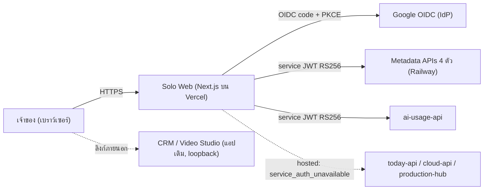
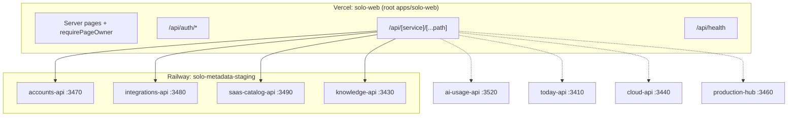

# 02 — System Architecture (SA)

## 1. Context diagram

ขอบเขตระบบ: Solo Web เป็น **UI + thin BFF** ไม่มี domain logic และไม่มีฐานข้อมูลของตนเอง แต่ละ backend ตรวจสิทธิ์และถือข้อมูลของตนเอง (แผน migration "Global Constraints")

## 2. Components / containers

| Component | ที่อยู่ใน source | หน้าที่ |
|---|---|---|
| App shell + เมนู | `app/layout.tsx`, `components/shell-nav.tsx`, `lib/modules.ts` | `<html lang="th">`, เมนูหลัก, ปุ่มออกจากระบบ |
| Pages ราย module | `app/<module>/page.tsx` | ตรวจ owner session ฝั่ง server (`requirePageOwner`) แล้ว render client ของ module |
| Module clients | `modules/<module>/{client.tsx,api.ts,module.css}` | UI และ client API ที่เรียก `/api/<module>/v1/...`; CSS ถูกครอบด้วย `.m-<module>` |
| Auth routes | `app/api/auth/{login,callback,logout,session}/route.ts`, `lib/auth-routes.ts` | OIDC flow, ตั้ง/ลบ cookie, ตรวจ session |
| Auth core | `lib/auth.ts` | readiness, JWE session, owner allowlist, OIDC discovery, service JWT |
| Request guard | `lib/request-guard.ts` | Host allowlist, Origin ตรงทุกตัวอักษรสำหรับ mutation, JSON-only, local demo |
| BFF proxy | `app/api/[service]/[...path]/route.ts`, `lib/backends.ts` | forward `/api/<service>/<path>` → `<ORIGIN>/api/<path>` ตาม allowlist |
| Health | `app/api/health/route.ts` | configuration readiness (ไม่ตรวจ live backend) |
| Tooling | `scripts/scope-css.mjs`, `scripts/staging-preflight.mjs`, `scripts/staging-smoke.mjs` | scope CSS, ตรวจ config, smoke หลัง deploy |

เส้นประ = มีใน registry แต่ยังไม่อยู่ใน staging target ของ phase แรก

## 3. Tech stack

| ชั้น | เทคโนโลยี | หลักฐาน |
|---|---|---|
| Frontend/BFF | Next.js `16.3.8`, React `19.3.0`, TypeScript, Node.js `22.x` (Vercel project setting) | `package.json`, `staging-targets.json` |
| Auth | `openid-client` `^6.8.8`, `jose` `^6.2.12` (JWE `dir`/`A256GCM`, JWT RS256) | `package.json`, `lib/auth.ts` |
| Test | `vitest` `^5.0.1`, `node --test` | `package.json`, `scripts/*.test.mjs` |
| Backend APIs | Python 3.12 (`python:3.12-slim`), `http.server.ThreadingHTTPServer`, `packages/service-auth` | `services/accounts-api/Dockerfile`, `server.py` |
| Hosting | Vercel (web), Railway Dockerfile builder (APIs) | `vercel.json`, `services/*/railway.toml` |

## 4. Data stores

Solo Web ไม่มี data store ฝั่ง server ข้อมูลฝั่ง browser มีเพียง:

| ที่เก็บ | ข้อมูล | อายุ |
|---|---|---|
| Cookie `__Host-solo-oidc` | JWE ของ PKCE verifier/state/nonce | 10 นาที |
| Cookie `__Host-solo-session` | JWE ของ `sub`, `tenant_id=owner` | ≤1 ชม. และ ≤ ID-token `exp` |
| `localStorage` (module AI Usage) | ID เหตุการณ์แจ้งเตือน + เวลารีเซ็ต | หมดอายุหลังรีเซ็ต |
| หน่วยความจำหน้า (module accounts/integrations/saas/knowledge) | access token ที่ผู้ใช้กรอกเอง (โหมด local) | จนปิด/ล้างหน้า |

Metadata APIs อ่าน **snapshot ที่ bake เข้า image** (ไม่มี DB): `accounts/ACCOUNT-MATRIX.yaml`, `infra/api/external_app_registry.ts` + `integrations/`, `systems/cloud-platform/free-saas-master-catalog-2026.json`, `data/indexes/document-catalog.json` (ตาม `service.yaml` `data.reads`)

## 5. Integrations

| ระบบภายนอก | ใช้ทำอะไร | สัญญา |
|---|---|---|
| Google OIDC (`https://accounts.google.com`) | owner login, scope `openid` | authorization code + PKCE S256, callback `<origin>/api/auth/callback` |
| Metadata APIs | อ่านข้อมูลราย module | `solo-empire.<module>.v1` + service JWT (ดู `12-trd-api-data.md`) |
| Secret store (Infisical) | เก็บค่าลับของ runtime | ชื่อตัวแปรเท่านั้น; reference ของ Solo Web **[ต้องยืนยัน]** |

## 6. Deployment topology

| Runtime | Provider | Resource | สถานะ (observed 2026-10-04/05) |
|---|---|---|---|
| Solo Web | Vercel | project `solo-web-staging`, env preview, root `apps/solo-web`, domain สำรอง `solo-web-staging.vercel.app` | `created_empty`, ยังไม่ deploy/assign domain |
| 4 metadata APIs | Railway | project `solo-metadata-staging`, env `staging`, region `us-west2` | `staged-create`, ยังไม่มี image/source |

IDs ของ provider อยู่ใน `apps/solo-web/deployment/staging-targets.json` (ไม่คัดลอกมาที่นี่) ค่าเป้าหมาย region คือ Singapore ถ้าบัญชีรองรับ **[ต้องยืนยัน]**

## 7. ADR สำคัญ

| ID | การตัดสินใจ | เหตุผล | แหล่ง |
|---|---|---|---|
| ADR-01 | webapp เดียว, backend แยกราย module ผ่าน origin env ของแต่ละตัว | scale/ย้าย backend ได้ไม่แตะ frontend | spec unified web shell §0, §2 |
| ADR-02 | BFF ไม่มี domain logic, ไม่มี gateway กลางทางธุรกิจ, auth ตรวจในแต่ละ service | ลด coupling | แผน migration Global Constraints |
| ADR-03 | Vercel สำหรับเว็บ, Railway สำหรับ backend (แทน Render) | owner decision 2026-10-05 | `service-deployments.yaml` `hosting_decision` |
| ADR-04 | Owner OIDC + allowlist `sub`, tenant เดียว; ไม่เก็บ provider/access/refresh token | ลด attack surface | `README.md` Authentication |
| ADR-05 | BFF ออก service JWT ใหม่ต่อ request (audience/scope รายบริการ, ≤120 วินาที) และไม่ส่งต่อ `Authorization`/cookie ของผู้เรียก | ป้องกัน confused deputy | `lib/auth.ts`, `README.md` Proxy |
| ADR-06 | Production ไม่มี loopback/default-origin fallback; remote ต้อง HTTPS + `<SERVICE>_ALLOW_REMOTE=true` | ป้องกันชี้ backend ผิดที่ | `lib/backends.ts` |
| ADR-07 | ค่าใช้จ่าย value-first, กรอบวางแผน US$30–50/เดือน | owner decision 2026-10-05 | `staging-decision.md` |

## การอนุมัติ

| บทบาท | สถานะ | วันที่ | ลงนาม |
|---|---|---|---|
| Solution Architect | รอพิจารณา | — | __________ |

## แหล่งข้อมูล

- `apps/solo-web/lib/{auth.ts,backends.ts,request-guard.ts,modules.ts,page-auth.ts}`, `apps/solo-web/app/**`
- `apps/solo-web/package.json`, `apps/solo-web/vercel.json`, `apps/solo-web/next.config.ts`
- `services/{accounts-api,integrations-api,saas-catalog-api,knowledge-api,ai-usage-api}/service.yaml`, `services/accounts-api/Dockerfile`, `services/accounts-api/railway.toml`
- `apps/solo-web/deployment/staging-targets.json`, `apps/solo-web/deployment/staging-decision.md`
- `docs/superpowers/specs/2026-09-30-unified-web-shell-design.md`, `docs/superpowers/plans/2026-10-04-vercel-distributed-paas-migration.md`
- `repository-catalog/registries/service-deployments.yaml`
