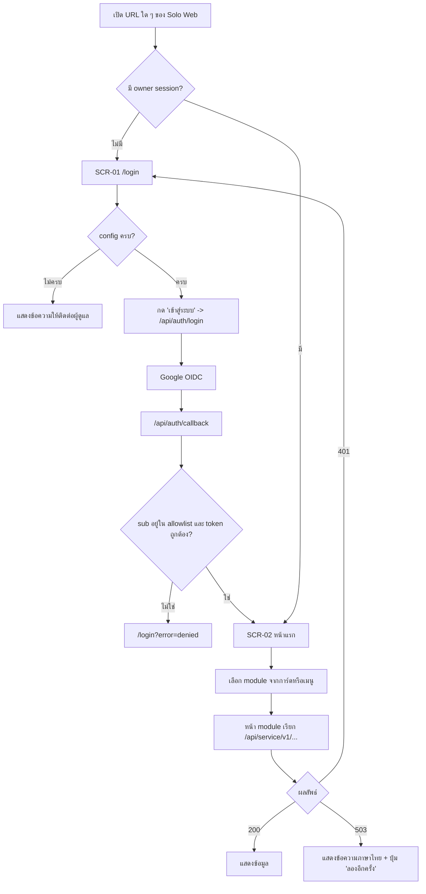
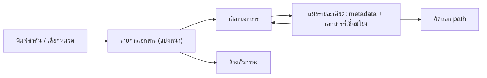
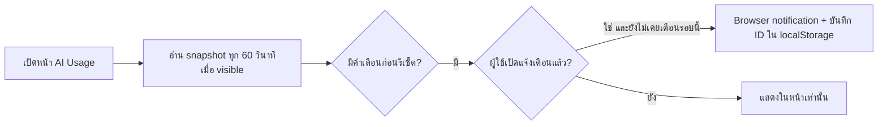

# 06 — User Flow และ Screen Inventory

## 1. รายการหน้าจอ

ได้จาก `app/**/page.tsx`, `lib/modules.ts` และ heading ใน `modules/*/client.tsx`

| ID | Route | ชื่อ (heading) | บทบาท | Backend | สถานะ |
|---|---|---|---|---|---|
| SCR-01 | `/login` | เข้าสู่ระบบ Solo Empire | Anonymous | — | สร้างแล้ว |
| SCR-02 | `/` | Solo Empire (การ์ดรวม module) | Owner | — | สร้างแล้ว |
| SCR-03 | `/today` | วันนี้ทำอะไร | Owner | today-api | local เท่านั้น (hosted: service auth ยังไม่พร้อม) |
| SCR-04 | `/production` | Production Console — แท็บ คลังไฟล์ / โปรเจกต์ / เส้นทางแปลงไฟล์ / Flow | Owner | production-hub | local เท่านั้น |
| SCR-05 | `/knowledge` | ความรู้ที่หาเจอ (+ แผงรายละเอียดเอกสาร "ตามรอยความรู้") | Owner | knowledge-api | phase 1 |
| SCR-06 | `/cloud` | เห็น cloud | Owner | cloud-api | local เท่านั้น |
| SCR-07 | `/ai-usage` | AI Usage | Owner | ai-usage-api | สร้างแล้ว; phase **[ต้องยืนยัน]** |
| SCR-08 | `/accounts` | บัญชีทุกแพลตฟอร์ม | Owner | accounts-api | phase 1 |
| SCR-09 | `/integrations` | แอปภายนอกที่เชื่อมแล้ว | Owner | integrations-api | phase 1 |
| SCR-10 | `/saas` | บริการฟรีที่เลือกใช้ได้ | Owner | saas-catalog-api | phase 1 |
| EXT-01 | `http://127.0.0.1:3200` | CRM (แอปเดิม) | Owner | crm-api | ลิงก์ภายนอก, ยังไม่ย้าย |
| EXT-02 | `http://127.0.0.1:3400` | วิดีโอ / Video Studio (แอปเดิม) | Owner | video-postproduction-api | ลิงก์ภายนอก, ยังไม่ย้าย |

หมายเหตุ: EXT-01/EXT-02 ชี้ loopback จึงใช้ได้เฉพาะเครื่อง local; บน hosted ลิงก์จะเสีย **[ต้องยืนยัน]** ว่าจะซ่อนเมนูนี้บน hosted หรือไม่

## 2. User flow หลัก

### 2.1 Login และเข้าใช้ module

### 2.2 ค้นเอกสารในคลังความรู้ (SCR-05)

### 2.3 AI Usage แจ้งเตือน (SCR-07)

### 2.4 Logout

ปุ่ม "ออกจากระบบ" ในเมนู (ซ่อนบน `/login`) ส่ง form POST `/api/auth/logout` → redirect `/login`

## 3. หลัก design system / component

- **Shell:** `components/shell-nav.tsx` (`<nav aria-label="เมนูหลัก">`, `aria-current="page"` บน module ปัจจุบัน), class `shell-home`, `shell-cards`, `shell-card` ใน `app/globals.css`
- **CSS แยก module:** `scripts/scope-css.mjs` ครอบ selector ด้วย `.m-<module>` และเปลี่ยนชื่อ `@keyframes` เป็น `m-<module>-<name>`; module คง style เดิมจากแอปเก่า จึงหน้าตาไม่เป็นชุดเดียวกันทั้งหมด **[สมมติฐาน]** ไม่มี design token กลาง
- **รูปแบบซ้ำในหน้า metadata:** สรุปตัวเลข (`aria-label="สรุป..."`), ช่องค้นหา + select ตัวกรอง, ปุ่ม "ล้างตัวกรอง"/"รีเฟรช"/"ลองอีกครั้ง", แบ่งหน้า "ก่อนหน้า"/ถัดไป, footer แสดงเวลาข้อมูล
- **Accessibility:** ใช้ `aria-label`, `role="alert"`/`role="status"` สำหรับข้อความสถานะ; ยังไม่มีผลตรวจ a11y อัตโนมัติ **[ต้องยืนยัน]**
- **ภาษา:** ป้ายและข้อความ error เป็นภาษาไทย, technical identifiers คงเดิม
- ไม่มีไฟล์ Figma/mockup ของ Solo Web ใน repo **[ต้องยืนยัน]**

## การอนุมัติ

| บทบาท | สถานะ | วันที่ | ลงนาม |
|---|---|---|---|
| UX/UI | รอพิจารณา | — | __________ |

## แหล่งข้อมูล

- `apps/solo-web/app/*/page.tsx`, `apps/solo-web/app/login/page.tsx`, `apps/solo-web/app/page.tsx`, `apps/solo-web/app/layout.tsx`
- `apps/solo-web/lib/modules.ts`, `apps/solo-web/components/shell-nav.tsx`
- `apps/solo-web/modules/*/client.tsx`, `apps/solo-web/modules/production/routes.tsx`
- `apps/solo-web/scripts/scope-css.mjs`, `apps/solo-web/README.md` (AI Usage)
