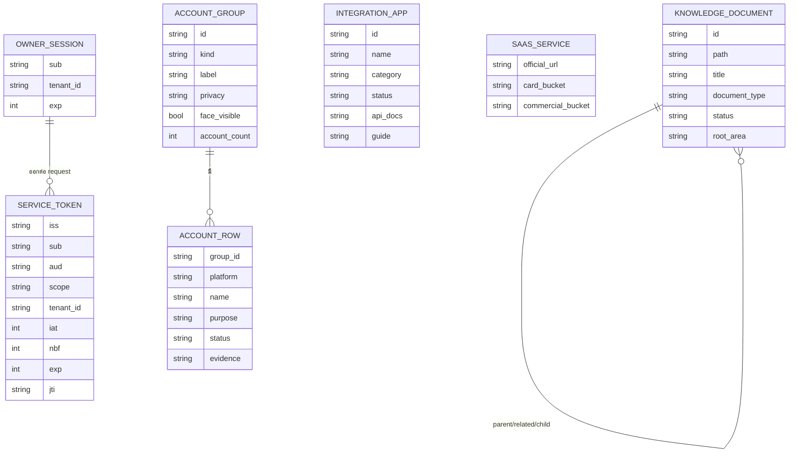
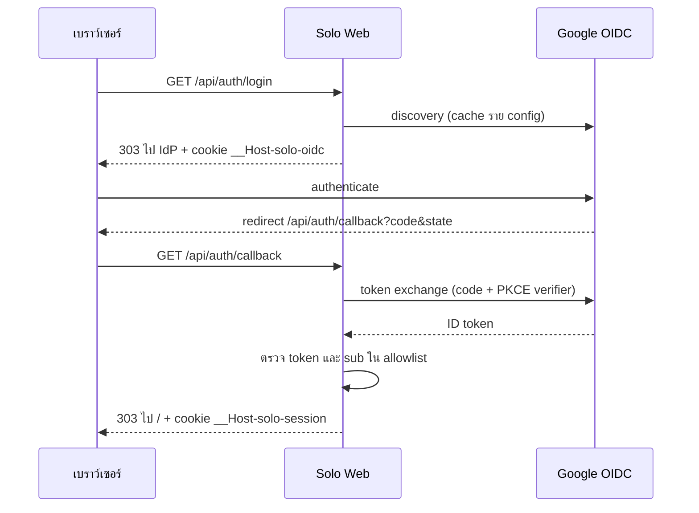
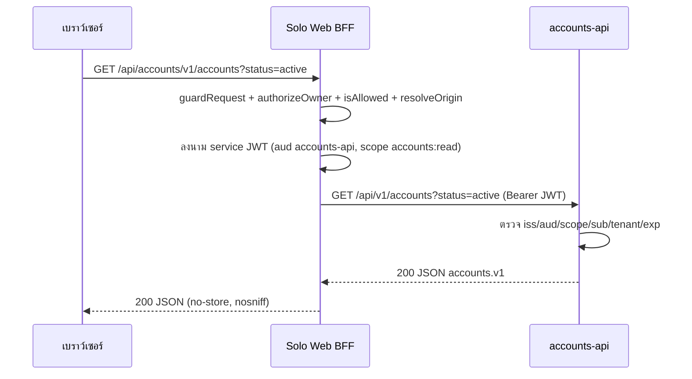

# 12 — TRD: API และ Data Model

## 1. ER diagram (logical)

Solo Web ไม่มีฐานข้อมูล แผนภาพด้านล่างคือ **โครงสร้างข้อมูลเชิงตรรกะ** ที่ BFF และ metadata APIs ใช้ (session/token และ read projection) ไม่ใช่ตารางจริง

## 2. Entity / แหล่งข้อมูล

| Entity | แหล่งจริง (canonical) | เจ้าของข้อมูล | หมายเหตุ |
|---|---|---|---|
| OWNER_SESSION | cookie JWE `__Host-solo-session` | Solo Web | ไม่มี server-side store |
| OIDC transaction | cookie JWE `__Host-solo-oidc` (`verifier`, `state`, `nonce`) | Solo Web | อายุ 600 วินาที |
| SERVICE_TOKEN | ออกใหม่ต่อ request, ไม่เก็บ | Solo Web | RS256, ≤120 วินาที |
| ACCOUNT_* | `accounts/ACCOUNT-MATRIX.yaml` | `solo-empire-account-matrix` | anonymous identities คืนเฉพาะ `identities`, `platform_slots`, `by_status` |
| INTEGRATION_APP | `infra/api/external_app_registry.ts` | `solo-empire-external-app-registry` | `guide` เป็น pointer ไม่ใช่ body |
| SAAS_SERVICE | `systems/cloud-platform/free-saas-master-catalog-2026.json` | `solo-empire-free-saas-catalog` | snapshot มีวันที่, text ตัดที่ 400 ตัวอักษร |
| KNOWLEDGE_DOCUMENT | `data/indexes/document-catalog.json` | `solo-empire-document-catalog` | metadata เท่านั้น ไม่มี body |
| AI usage snapshot | private sanitized snapshots (`AI_USAGE_STATE_DIR`) | `solo-empire-ai-usage-local` | ไม่อยู่ใน staging phase 1 **[ต้องยืนยัน]** |

## 3. API endpoints

### 3.1 Solo Web (Next.js route handlers)

| Method | Path | Auth | หน้าที่ |
|---|---|---|---|
| GET | `/api/auth/login` | Host guard | เริ่ม OIDC; ตั้ง transaction cookie; 303 ไป IdP หรือ `/login?error=configuration` หรือ `/login?error=unavailable` |
| GET | `/api/auth/callback` | Host guard + transaction cookie | แลก code, ตรวจ ID token, ตั้ง session, 303 ไป `/` หรือ `/login?error=denied` |
| POST | `/api/auth/logout` | Host + same Origin | ลบ cookies, 303 ไป `/login` |
| GET | `/api/auth/session` | Host guard | `{authenticated: boolean}` 200/401 |
| GET | `/api/health` | ไม่ต้อง login | config readiness; 200 `ready` / 503 `configuration_required` |
| GET/POST/PATCH | `/api/{service}/{...path}` | Host guard + owner session (+ Origin/JSON สำหรับ write) | forward ไป `<ORIGIN>/api/{path}` ตาม allowlist |

### 3.2 Proxy allowlist (จาก `lib/backends.ts`)

| service | Origin env | Methods | Paths (หลัง `/api/<service>/`) | Timeout | Audience / scope |
|---|---|---|---|---|---|
| `accounts` | `ACCOUNTS_API_ORIGIN` | GET | `v1/accounts` | 8 วินาที | `accounts-api` / `accounts:read` |
| `integrations` | `INTEGRATIONS_API_ORIGIN` | GET | `v1/integrations` | 8 วินาที | `integrations-api` / `integrations:read` |
| `saas` | `SAAS_CATALOG_API_ORIGIN` | GET | `v1/saas` | 8 วินาที | `saas-catalog-api` / `saas:read` |
| `knowledge` | `KNOWLEDGE_API_ORIGIN` | GET | `v1/knowledge`, `v1/knowledge/document` | 8 วินาที | `knowledge-api` / `knowledge:read` |
| `ai-usage` | `AI_USAGE_API_ORIGIN` | GET | `v1/ai-usage` | 8 วินาที | `ai-usage-api` / `ai-usage:read` |
| `today` | `TODAY_API_ORIGIN` | GET, PATCH | `v1/today`, `v1/tasks/<id>` | 10 วินาที | ไม่มี (hosted: `service_auth_unavailable`) |
| `cloud` | `CLOUD_API_ORIGIN` | GET | `v1/cloud/usage`, `v1/paas/inventory`, `v1/paas/actions` | 15 วินาที | ไม่มี |
| `production` | `PRODUCTION_HUB_API_ORIGIN` | GET, POST | `v1/health`, `v1/registry`, `v1/artifacts`, `v1/artifacts/<sha256>` (+ `/lineage`, `/content`), `v1/projects`, `v1/projects/<slug>` (+ `/review`, `/assign`, `/package`), `v1/send`, `v1/flows`, `v1/flows/<id>` (+ `/resume`), `v1/jobs/<job>`, `v1/flow-templates`, `v1/flow-templates/<slug>`, `v1/formats`, `v1/runtimes`, `v1/path` | 30 วินาที | ไม่มี (local demo ใช้ `X-Hub-Client` + legacy token) |

### 3.3 Metadata APIs (Python, Railway)

| Method | Path | Auth | หน้าที่ |
|---|---|---|---|
| GET | `/health` | public | liveness + schema version |
| GET | `/ready` | public | `status`, `source` (available/unavailable), `auth` (ready/development/disabled); 200 เมื่อ source + JWT config พร้อม, มิฉะนั้น 503; ไม่มี rows |
| GET | `/api/v1/accounts` | service JWT | ตัวกรอง `status`, `platform`, `kind`, `q` (≤80) |
| GET | `/api/v1/integrations` | service JWT | ตัวกรอง `status`, `category`, `q` (≤80) |
| GET | `/api/v1/saas` | service JWT | ตัวกรอง `category`, `card`, `commercial`, `q`, `limit` 1–100, `offset` 0–5000 |
| GET | `/api/v1/knowledge` | service JWT | `q` (≤120), `root_area`, `document_type`, `status`, `tag`, `limit`, `offset` |
| GET | `/api/v1/knowledge/document?path=` | service JWT | รายละเอียด + neighbors; รับเฉพาะ path `.md`/`.mdx` ที่อยู่ใน catalog |

Error envelope ทุก API: `{"error": {"code", "message"}}`; 401 token ไม่ถูกต้อง, 403 owner/tenant/scope ไม่ผ่าน, 405 method อื่น, 503 config/source ไม่พร้อม (เช่น `matrix_unavailable`, `registry_unavailable`, `catalog_unavailable`)

## 4. Integration contracts

| Contract | ข้อกำหนด |
|---|---|
| Service JWT (Web → API) | header `alg=RS256, typ=JWT`; claims `iss` = `SOLO_WEB_PUBLIC_ORIGIN` (normalize), `sub` = OIDC `sub`, `aud` ราย API, `scope` ราย API, `tenant_id=owner`, `iat`, `nbf`, `exp ≤ iat+120` และ ≤ session `exp`, `jti` ใหม่ (UUID); API ตรวจด้วย `<NAME>_API_AUTH_ISSUER`, `<NAME>_API_AUTH_PUBLIC_KEY`, `<NAME>_API_AUTH_SUBJECTS`, leeway 5 วินาที |
| Proxy forwarding | ส่งเฉพาะ `Accept: application/json`, `Content-Type: application/json` (เมื่อมี body) และ `Authorization` ที่ BFF ออก; ไม่ส่ง cookie/caller `Authorization`/`X-Owner`; `redirect: 'error'`; คืน `Cache-Control: no-store`, `nosniff` |
| OIDC (Web ↔ IdP) | discovery จาก `SOLO_WEB_OIDC_ISSUER` (timeout 10 วินาที), `response_type=code`, `scope=openid`, PKCE S256, `redirect_uri=<origin>/api/auth/callback` |
| Schema versions | `solo-empire.accounts.v1`, `solo-empire.integrations.v1`, `solo-empire.saas-catalog.v1`, `solo-empire.knowledge.v1`; `source.revision` = SHA-256 ของ source (additive) |
| Service manifest | `solo-empire.service.v1` (`service.yaml`): `data.reads`, `writes: []`, `secrets: []`, `deploy.target: unassigned` |

## 5. Sequence diagrams

### 5.1 Login

### 5.2 อ่าน metadata ผ่าน BFF

## การอนุมัติ

| บทบาท | สถานะ | วันที่ | ลงนาม |
|---|---|---|---|
| Solution Architect | รอพิจารณา | — | __________ |

## แหล่งข้อมูล

- `apps/solo-web/lib/{auth.ts,backends.ts,request-guard.ts,auth-routes.ts}`, `apps/solo-web/app/api/**/route.ts`
- `services/accounts-api/contracts/accounts.v1.md`, `services/integrations-api/contracts/integrations.v1.md`, `services/saas-catalog-api/contracts/saas-catalog.v1.md`, `services/knowledge-api/contracts/knowledge.v1.md`
- `services/{accounts-api,integrations-api,saas-catalog-api,knowledge-api,ai-usage-api}/service.yaml`
- `apps/solo-web/README.md` (Proxy, Authentication และ Vercel)
