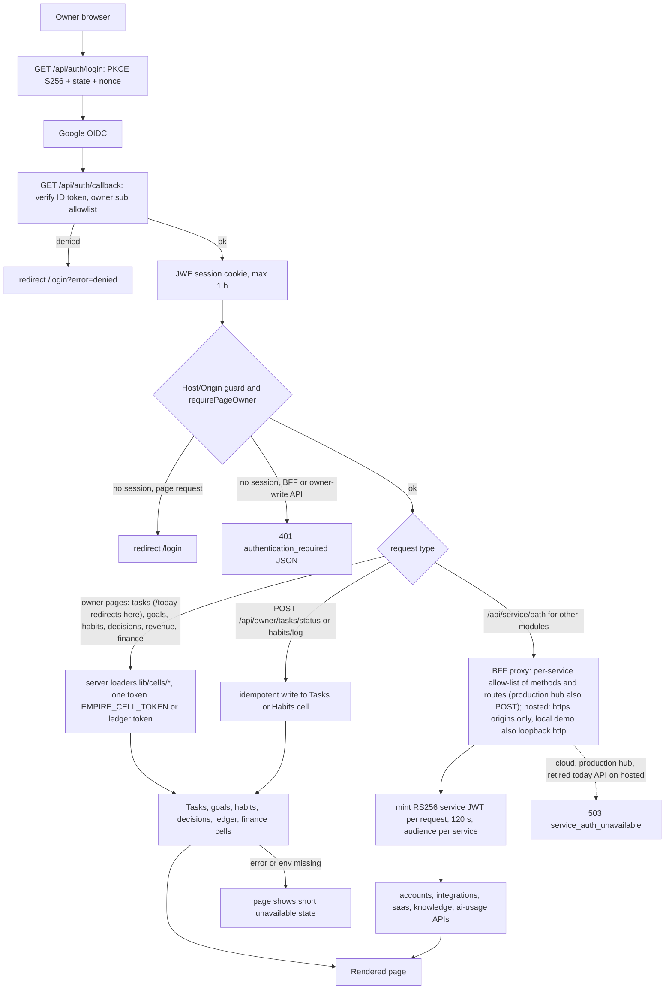
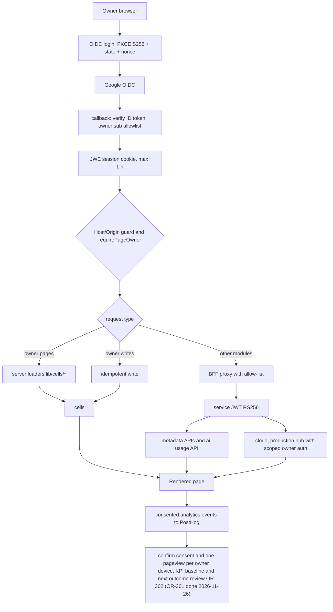

# 01 — Business process (As-Is / To-Be)

life-dashboard-web (Solo Web) คือเว็บ Next.js บน Vercel สำหรับ owner คนเดียว ใช้เปิดงานวันนี้ เป้าหมาย นิสัย การตัดสินใจ รายได้ และหน้าการเงิน โดยเป็นแค่ UI กับ BFF บาง ๆ ที่อ่านข้อมูลจาก cell/backend แต่ละตัวฝั่ง server ไม่เก็บข้อมูลเองและไม่ส่ง token ไป client

Last reviewed: 2026-11-27 · commit `66b1c78`

## As-Is (จากโค้ดวันนี้)

บทบาทอื่นจากโค้ด: `GET /api/health` ตอบสถานะ configuration (ไม่ใช่ live backend), `/.well-known/jwks.json` เปิดกุญแจสาธารณะให้ backend ตรวจ JWT, analytics (PostHog) ปิดเป็นค่าเริ่มต้นและรอ consent, Sentry ส่งเฉพาะ error ที่ผ่าน allowlist ใน `lib/sentry.ts` และมี `.autopilot/` + `.github/workflows/autopilot.yml` รันตาม cron [ต้องยืนยัน] ว่า autopilot เปิดใช้จริงอยู่ในตอนนี้ และ [ต้องยืนยัน] ว่า Vercel project `owner-web` ยังไม่ผูก Git (PRODUCT.md เขียนไว้แบบนั้น) หรือผูกแล้ว

Sources: `lib/auth-routes.ts`, `lib/auth.ts`, `lib/page-auth.ts`, `app/api/[service]/[...path]/route.ts`, `lib/backends.ts`, `lib/cells/core.ts`, `lib/cells/loaders.ts`, `app/api/owner/*/route.ts`, `app/api/health/route.ts`, `README.md`, `PRODUCT.md`, `DOCPACK/02-architecture.md`

## To-Be (DOCPACK/08-rtm.md, docs/measurement/GO-LIVE.md, DOCPACK/02-architecture.md)

Sources: `DOCPACK/08-rtm.md` §Gaps (GAP-01, GAP-02, GAP-03, GAP-05, GAP-06), `DOCPACK/02-architecture.md` §Context diagram, `docs/measurement/GO-LIVE.md` steps 5-8

## Gap

| ID | As-Is → To-Be | Status | Owner | Evidence |
|---|---|---|---|---|
| G1 | cloud/production hub ตอบ `service_auth_unavailable` บน hosted → backend รองรับ scoped owner auth และหน้าใช้งานได้ (หน้า `/today` redirect ไป `/tasks` ที่อ่านจาก Tasks cell แล้ว; Today API เดิมเลิกใช้ ไม่อยู่ในงานนี้) | blocked | claude | `DOCPACK/02-architecture.md` context diagram; `README.md` §Authentication และ Vercel |
| G2 | ไม่มี browser E2E ของ owner journey (login Google จริง) → ชุด browser acceptance | todo | claude | `DOCPACK/08-rtm.md` GAP-01 |
| G3 | hosted smoke/UAT ยังไม่ได้รัน → รัน smoke/UAT และเก็บหลักฐาน | todo | owner | `DOCPACK/08-rtm.md` GAP-05 |
| G4 | ไม่มี NFR วัดได้ (latency, uptime, RTO, RPO) → owner กำหนดเป้าหมาย | decide | owner | `DOCPACK/08-rtm.md` GAP-06 |
| G5 | parity test JWT Web ↔ Python ถูกข้ามใน CI → ติดตั้งแพ็กเกจ `service_auth` ใน Python environment ของ CI แล้วตั้ง `SERVICE_AUTH_PYTHON` ชี้ไปยัง interpreter นั้น (ตั้งตัวแปรอย่างเดียว test จะล้มตอน import) | todo | claude | `DOCPACK/08-rtm.md` GAP-03 |
| G6 | PostHog insight check และ dashboard "Life Dashboard pilot" ยังไม่ทำ; OR-301 จบแล้ว (owner อนุมัติ 2026-11-26: ผล not measurable) → ยืนยัน consent และ `$pageview` บนอุปกรณ์ owner, สร้าง dashboard, เก็บ baseline และทำ outcome review ที่ OR-302 (2026-12-25) | doing | owner | `docs/measurement/GO-LIVE.md` steps 5-8; `docs/measurement/OUTCOME-REVIEW-001.md` |

## Open questions

- Vercel project `owner-web` ผูกกับ Git แล้วหรือยัง (PRODUCT.md และ GO-LIVE.md บอกว่ายังไม่ผูก; ต้องยืนยันกับ Vercel)
- สถานะ GAP-02 และ GAP-07 ใน RTM: GAP-02 ปิดส่วน view test แล้ว, GAP-07 มี `.github/workflows/ci.yml` ใน repo แล้ว แต่ RTM ยังไม่อัปเดตให้ตรง
